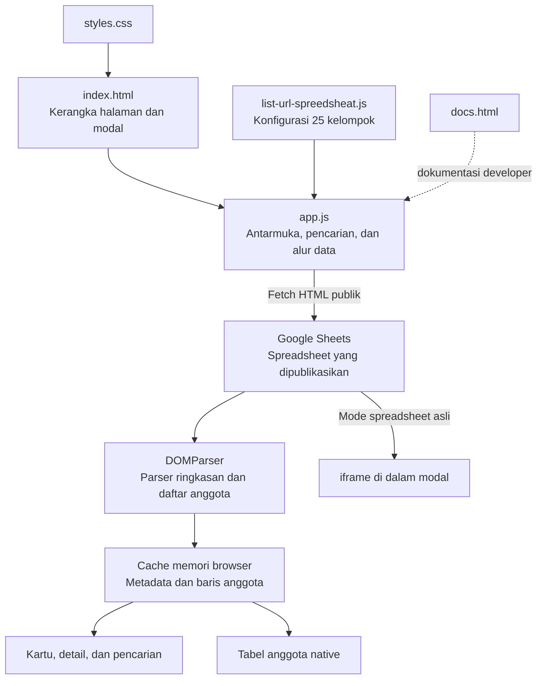

<p align="center">
  
</p>

<h1 align="center">OpenLP2M - UMPR</h1>

<p align="center">
  Direktori responsif untuk mencari informasi anggota 25 kelompok KKN 51 UMPR 2026.
</p>

<p align="center">
  
  
  
</p>

> **Catatan:** Ini proyek independen dan bukan situs resmi Lembaga Penelitian dan Pengabdian kepada Masyarakat Universitas Muhammadiyah Palangka Raya. Dikembangkan oleh [@winkykurniatama](https://github.com/winkyid).

## Tentang

OpenLP2M - UMPR adalah situs statis yang menyajikan data publik kelompok KKN 51 UMPR 2026. Pengunjung dapat mencari kelompok berdasarkan nama mahasiswa, NIM, program studi, fakultas, angkatan, atau informasi kelompok, lalu melihat detailnya dalam tabel native atau spreadsheet asli.

## Fitur

- Daftar 25 kelompok dengan pencarian langsung dari data anggota.
- Pencarian yang tidak peka huruf besar/kecil dan aksen; NIM dapat dicari dengan atau tanpa tanda titik.
- Detail kelompok berisi DPL, jumlah anggota, lokasi, keterangan, dan pratinjau gambar jika tersedia.
- Tabel anggota native yang dibuat dari data spreadsheet, dengan scroll yang mendukung layar mobile.
- Tampilan spreadsheet asli di dalam modal.
- Skeleton kartu dan indikator loading saat data dimuat.
- Halaman dokumentasi teknis developer di `docs.html`.
- Metadata Open Graph untuk pratinjau tautan dan favicon bermerek.

## Arsitektur sistem



### Alur pengolahan data

1. `list-url-spreedsheat.js` menyediakan konfigurasi 25 kelompok, termasuk URL spreadsheet dan `gid` masing-masing.
2. `app.js` meminta halaman HTML publik spreadsheet menggunakan `fetch`. Spreadsheet harus dipublikasikan dan mengizinkan akses lintas origin (CORS).
3. `DOMParser` membaca dokumen tanpa menyisipkan HTML spreadsheet langsung ke halaman.
4. Ringkasan kelompok diambil dari baris 3 (`{gid}R2`). Header tabel anggota berada di baris 4 (`{gid}R3`), dan baris berikutnya dipakai sebagai data anggota.
5. Hasil yang berhasil dimuat disimpan di `Map` selama halaman terbuka. Cache ini dipakai untuk pencarian dan tabel native tanpa mengambil ulang data.
6. Mode spreadsheet asli memuat URL publik kelompok di `iframe`; mode native menyusun tabel HTML dari baris anggota.

## Struktur berkas

| Berkas | Tanggung jawab |
| --- | --- |
| `index.html` | Halaman daftar, pencarian, detail kelompok, dan modal tampilan spreadsheet. |
| `app.js` | Sinkronisasi data, parsing, cache, pencarian, render kartu/tabel, dan pengelolaan modal. |
| `list-url-spreedsheat.js` | Konfigurasi URL spreadsheet dan data dasar untuk 25 kelompok. |
| `styles.css` | Gaya responsif, skeleton loading, tabel, dialog, dan dokumentasi. |
| `docs.html` | Dokumentasi teknis dan contoh pengembangan untuk developer. |
| `data-open.html` | Referensi HTML spreadsheet yang digunakan untuk memahami struktur data sumber. |

Setiap entri kelompok menggunakan properti seperti `url_spreedsheet`, `url_preview_thumbnail`, `nama`, `dpl`, `lokasi`, dan `jumlah_anggota`. Metadata kelompok diperbarui dari spreadsheet saat halaman dimuat.

## Menjalankan secara lokal

Tidak diperlukan proses build atau instalasi dependensi. Jalankan server statis dari direktori proyek:

```bash
python3 -m http.server 8000
```

Buka `http://localhost:8000` di browser. Gunakan server lokal, bukan membuka `index.html` langsung sebagai `file://`, agar perilaku request lintas origin dapat diuji dengan benar.

## Deploy ke GitHub Pages

1. Pastikan `index.html`, `docs.html`, `app.js`, `styles.css`, dan `list-url-spreedsheat.js` berada di root repositori.
2. Di GitHub, buka **Settings → Pages**.
3. Pilih **Deploy from a branch**, lalu pilih branch dan folder root (`/`).
4. Setelah GitHub Pages menerbitkan situs, buka URL hasil deploy dan uji pencarian serta kedua mode tampilan.
5. Setelah URL final tersedia, tambahkan URL tersebut sebagai `og:url` dan canonical di halaman HTML agar identitas tautan berbagi tepat.

Saat ini proyek belum memiliki URL publik yang diterbitkan.

## Batasan dan privasi

- Situs tidak memiliki backend, autentikasi, atau penyimpanan data server-side. Data diambil dan diproses di browser pengunjung.
- Ketersediaan data bergantung pada publikasi spreadsheet, izin CORS, jaringan, serta struktur baris dan ID yang dipakai parser.
- Informasi anggota mengikuti izin publik spreadsheet sumber. Jangan memasukkan data privat ke spreadsheet yang dipublikasikan.
- Jika format Google Sheets berubah, parser di `app.js` dan kontrak baris pada dokumentasi developer mungkin perlu diperbarui.

## Lisensi

Proyek ini menggunakan lisensi MIT. Lihat berkas [`LICENSE`](./LICENSE) untuk ketentuan lengkap.